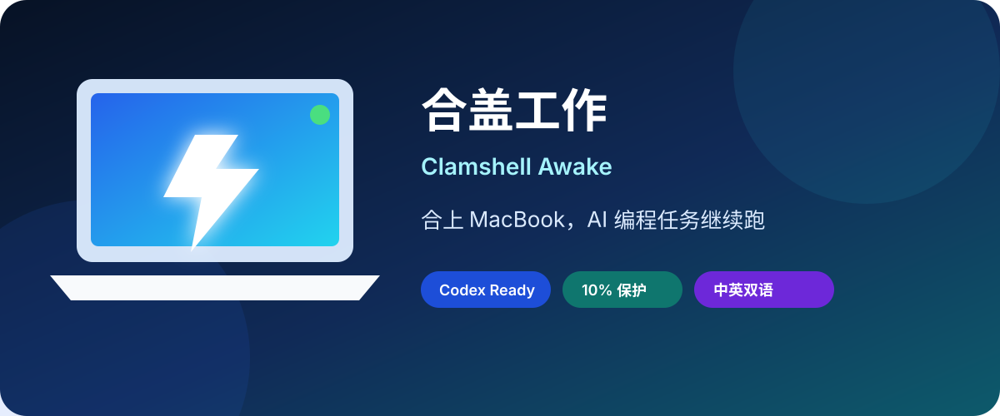

<div align="center">



# Clamshell Awake

**Close your MacBook. Keep Codex, Claude Code, terminal scripts, and downloads running.**

[中文](README.md) · [Download](https://github.com/TonT-wilshere/codex-clamshell-keep-awake/releases/latest) · [Report an issue](https://github.com/TonT-wilshere/codex-clamshell-keep-awake/issues)


[](https://github.com/TonT-wilshere/codex-clamshell-keep-awake/actions/workflows/ci.yml)
[](https://github.com/TonT-wilshere/codex-clamshell-keep-awake/releases/latest)
[](https://github.com/TonT-wilshere/codex-clamshell-keep-awake/releases)
[](https://github.com/TonT-wilshere/codex-clamshell-keep-awake/stargazers)

</div>

If you searched for “keep Mac awake with lid closed,” “prevent MacBook sleep during Codex,” “Claude Code stops when the lid closes,” or “keep an AI coding agent running,” this native macOS utility is built for that exact problem.

## Why

Long-running Codex and Claude Code tasks should not stop just because you close your MacBook. Clamshell Awake is a small, native macOS utility that keeps the machine awake with the lid closed, then safely restores normal sleep when you are done.

## Highlights

- Real clamshell support using macOS `pmset disablesleep`, not only idle-sleep prevention.
- Chinese / English UI switch that remembers your choice.
- Automatic safety shutdown at 10% battery.
- Built-in display dims to minimum after enabling and returns to its original brightness on disable or exit. External displays are untouched.
- Reads the kernel's actual `SleepDisabled` state before showing green.
- No sudoers edits, persistent root helper, account, network request, or telemetry.
- Universal binary for Apple Silicon and Intel; macOS 12 or newer.

## Install

1. Download the Universal `.dmg` (recommended) or `.zip` from [Releases](https://github.com/TonT-wilshere/codex-clamshell-keep-awake/releases/latest).
2. Move `合盖工作.app` to Applications.
3. This independent open-source build is not Apple-notarized. If macOS blocks the first launch, right-click the app in Finder and choose **Open**.
4. Click **Enable clamshell work mode** and approve the macOS administrator dialog.
5. Close the lid only after the status turns green.

Build from source with the macOS Swift toolchain; no third-party dependency is required:

```bash
git clone https://github.com/TonT-wilshere/codex-clamshell-keep-awake.git
cd codex-clamshell-keep-awake
./build.sh
open "build/合盖工作.app"
```

Maintainer instructions for Developer ID signing and Apple notarization are in [NOTARIZATION.md](NOTARIZATION.md). A normal `./build.sh` uses an ad-hoc signature for testing; a release must not be called notarized until Apple returns `Accepted` and the stapled artifacts pass Gatekeeper verification.

## Agent Skill

This repository includes a portable Agent Skill following the `SKILL.md` directory convention: [macos-clamshell-keep-awake](skills/macos-clamshell-keep-awake/SKILL.md). It helps Codex, Claude Code, and compatible agents recognize lid-close sleep problems, explain the difference between display sleep, system sleep, and shutdown, and guide users through safe installation and verification.

After cloning the repository, copy the skill directory for your agent:

```bash
# Codex
cp -R skills/macos-clamshell-keep-awake ~/.codex/skills/

# Claude Code
cp -R skills/macos-clamshell-keep-awake ~/.claude/skills/
```

See [llms.txt](llms.txt) for a concise, machine-readable project summary.

## Exact behavior

| Action / state | Clamshell mode | Built-in display |
| --- | --- | --- |
| Green “Enabled” state | Keeps working with lid closed | Minimum brightness |
| Close the window with the red button | **Still active**; window is only hidden | Stays at minimum |
| Reopen the app or use the menu bar | Control panel returns | Stays at minimum |
| Click Disable | Normal lid-close sleep returns | Original brightness returns |
| Quit from the menu bar | Restores sleep before quitting | Original brightness returns |
| Battery reaches 10% | Restores sleep automatically | Original brightness returns |
| Shut the Mac down | All tasks stop | — |

If the app is force-killed, its privileged watcher restores normal sleep when the app process disappears. On the next launch, the app also tries to restore the saved brightness. The keyboard brightness keys remain available as a manual fallback.

## Safety and privacy

Keep a running Mac on a hard, ventilated surface—never inside a bag. Administrator authentication is handled by macOS; the app cannot read or retain your password. Each session is bound to the current app process and a random one-time marker. The app installs no daemon, kernel extension, sudoers rule, or persistent privileged helper, and sends no data anywhere.

See [SECURITY.md](SECURITY.md) for the security model and reporting instructions.

## License

[MIT](LICENSE). Contributions are welcome—see [CONTRIBUTING.md](CONTRIBUTING.md).

If Clamshell Awake saved one long-running job, please leave a **Star**. It helps other local AI-agent users find the project. ⭐
